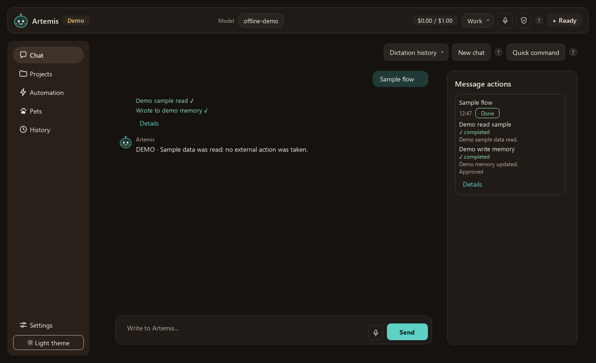
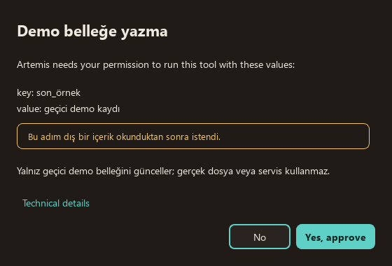
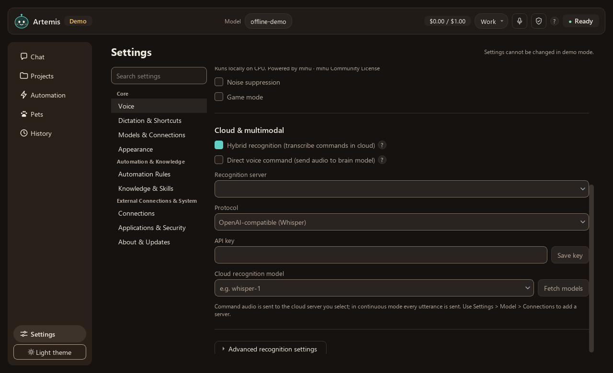
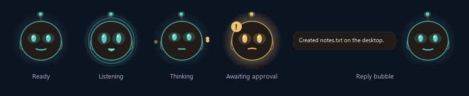
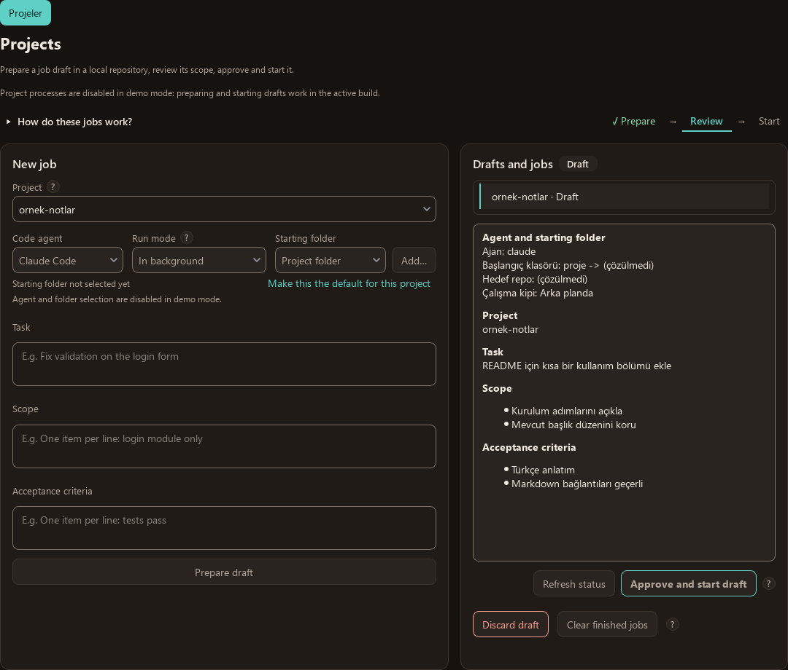

# Artemis

**English** | [Türkçe (README.tr.md)](README.tr.md)

[](https://github.com/UmutErayAltay/artemis/actions/workflows/ci.yml)
[](https://github.com/UmutErayAltay/artemis/releases)
[](LICENSE)
[](pyproject.toml)

A local-first personal desktop assistant for Windows 11 (Python 3.12 + PySide6; core also runs on Linux).
Desktop chat, voice pipeline, desktop pet, Telegram channel, and CLI share one provider-agnostic agent loop,
one **SafetyGate**, and 71 tools across 23 plugins. Risky actions and every side effect requested after reading
external content require explicit on-screen approval with full validated arguments; the default answer is **No**.

> **Status: Technical Preview.** Core logic (safety gate, tools, agent loop, UI, voice pipeline) is backed by
> 3,900+ automated tests on Windows and Ubuntu CI, strict `mypy`, ADR-documented design, and a 57-scenario fake safety
> benchmark. Live physical-device Windows acceptance is tracked in [docs/RELIABILITY_STATUS.md](docs/RELIABILITY_STATUS.md).
> Pre-built Windows installers are published on [Releases](https://github.com/UmutErayAltay/artemis/releases)
> (Apache-2.0 core; bundled GPL-3.0 Piper components noted in [THIRD_PARTY_NOTICES.md](THIRD_PARTY_NOTICES.md)).

## Desktop Preview

Screenshots are captured from real Qt windows in **demo mode** using synthetic data (`C:\Users\demo\...` — zero network calls or user files).



| Approval Gate | Voice Settings | Desktop Pet | Projects & Code Agents |
|---|---|---|---|
|  |  |  |  |

## Key Capabilities

- **One SafetyGate & Taint Tracking:** Every tool across chat, voice, Telegram, and routines passes through `SafetyGate`. Reading web/email/screen content taints the turn and forces explicit confirmation on outbound/side-effect tools.
- **UIA & Hybrid Computer Use (`ADR 0039`, `0073`, `0078`, `0089`):** Reads Windows UI Automation controls by name (works with text-only models), falls back to local Windows OCR and screenshots in `hybrid` mode, supports `hover` + a background strategist thinking layer when stalled, blocks destructive UI targets in code even in `auto` mode, and stops immediately on `Esc`.
- **Voice Pipeline & Model Health (`ADR 0067–0085`, `0088`):** Wake word (`"artemis"`), Push-to-Talk hotkey + 3-step Mic Wizard, Silero VAD, Smart Turn end-of-turn detection, local `faster-whisper` STT (TR/EN), optional hybrid cloud STT, Piper / Edge / Cloud / Gemini TTS with preview, optional DeepFilterNet3 & WebRTC AEC3, voice+vision multimodal screen context, and built-in model health/download manager with SHA-256 verification.
- **Contextual Work Profiles (`ADR 0083`):** One-click switching between **Work**, **Game** (lightweight STT, muted toasts), **Private** (strict local-only Ollama/Whisper/Piper; blocks cloud voice preview, cloud capture, Telegram channel, and `notify_telegram`), and **Meeting** (muted TTS/toasts).
- **Two-Way Calendar & Mail (`ADR 0084`):** Read-only IMAP/ICS plus strictly `CONFIRM_REQUIRED` CalDAV event creation and SMTP sending.
- **Proactive Automation & Teachable Macros (`ADR 0058`, `0061`, `0086`, `0087`):** Scheduled routines, file/app/calendar/power-resume event triggers, conditional suggestion chains, and a UIA + natural-language macro recorder that masks password/secret fields.
- **Graphical MCP Center & Code Agents (`ADR 0028`, `0032`, `0049`):** Manage stdio MCP servers, tool permissions, and health checks from Settings; includes Artemis's URL-validated browser MCP server and async code-agent job runner.
- **9-Page Settings & Live Budget Chip:** Consolidated Settings UI (`Appearance`, `Voice` with 4 subtabs, `Dictation & Shortcuts`, `Models & Connections`, `Automation Rules`, `Knowledge & Skills`, `Connections`, `Applications & Security`, `About & Updates`), live topbar `daily_budget_usd` counter, radial mouse selection menu (`ADR 0062`), and SHA-256 verified in-app updates (`ADR 0081`).
- **Privacy by Default:** Secrets live only in environment variables or Windows Credential Manager; raw audio and screenshots are never persisted to disk; SQLite self-memory supports Windows DPAPI encryption at rest (`ADR 0076`).

## Demo Videos

Generated with Remotion from real demo screenshots (English narration).
Turkish-narrated versions are in [README.tr.md](README.tr.md#tanıtım-videoları).

**Product tour (≈110 s)**

https://github.com/user-attachments/assets/f7be8b4a-4e45-457c-a95c-0430421a9009

**Setup guide (≈35 s)**

https://github.com/user-attachments/assets/d5ebb21b-0178-4df0-acb5-9b4f231e83d5

## Quick Start

### Option A: Windows Installer (No Admin Required)
Download `Artemis-Setup-<version>.exe` from [Releases](https://github.com/UmutErayAltay/artemis/releases) and verify its checksum against `SHA256SUMS.txt`.
*(Code signing through SignPath Foundation is being set up — see the [Code signing policy](docs/CODE_SIGNING_POLICY.md). Until a release is signed, Windows SmartScreen may warn.)*

### Option B: Run from Source (Windows / Linux, Python 3.12)

```powershell
# Windows PowerShell
$env:PYTHONUTF8 = '1'
py -3.12 -m venv .venv
.venv\Scripts\Activate.ps1
python -m pip install -e ".[desktop,voice]"
Copy-Item config/config.example.yaml config/config.yaml
New-Item -ItemType Directory -Force desktop
python -m artemis desktop --config config/config.yaml
```

```bash
# Linux bash (Ubuntu/Debian PySide6 Qt runtime libs)
sudo apt-get update && sudo apt-get install -y libegl1 libopengl0
python3.12 -m venv .venv
source .venv/bin/activate
python -m pip install -e '.[desktop,voice]'
cp config/config.example.yaml config/config.yaml
mkdir -p desktop
python -m artemis desktop --config config/config.yaml
```

First launch opens the **Connect Brain** wizard (OpenRouter OAuth PKCE, Google AI Studio Gemini, Claude CLI, or local Ollama/LM Studio on `127.0.0.1`) to configure `primary_model` / `models` (`[desktop,voice]` includes `numpy` required by desktop startup as well as local STT/TTS); `config/config.example.yaml` already defaults `workspace: ../desktop` and `allow_paid: false` unless explicitly permitting paid models.

## Verification

```powershell
# Install test/eval extras needed for pytest collection (or CI minimal: .[dev,desktop] + numpy==2.5.3 onnxruntime==1.31.0 livekit==1.1.20 pyarrow==25.0.1)
.\.venv\Scripts\python.exe -m pip install -e ".[dev,desktop,voice,eval]"
.\.venv\Scripts\python.exe -m pytest -q
.\.venv\Scripts\python.exe -m ruff check artemis tests bench
.\.venv\Scripts\python.exe -m mypy --config-file pyproject.toml artemis bench
.\.venv\Scripts\python.exe -m bench.run --sahte
```

## Documentation & License

- [README.tr.md](README.tr.md) — Full Turkish user guide
- [docs/ARCHITECTURE.md](docs/ARCHITECTURE.md) & [docs/adr/README.md](docs/adr/README.md) (Architecture Decision Records)
- [docs/RELIABILITY_STATUS.md](docs/RELIABILITY_STATUS.md) · [docs/TESTING.md](docs/TESTING.md) · [CONTRIBUTING.md](CONTRIBUTING.md)
- [Code signing policy](docs/CODE_SIGNING_POLICY.md) · [Privacy policy](docs/PRIVACY.md)

Licensed under [Apache-2.0](LICENSE). Third-party binary notices: [THIRD_PARTY_NOTICES.md](THIRD_PARTY_NOTICES.md).
