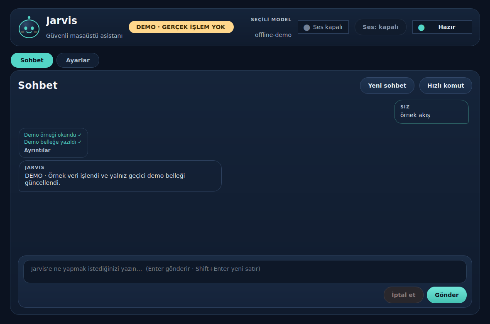
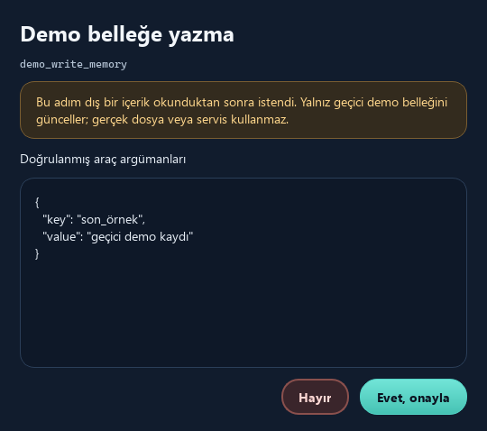
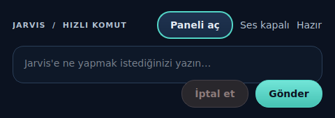
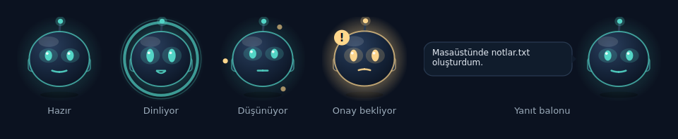
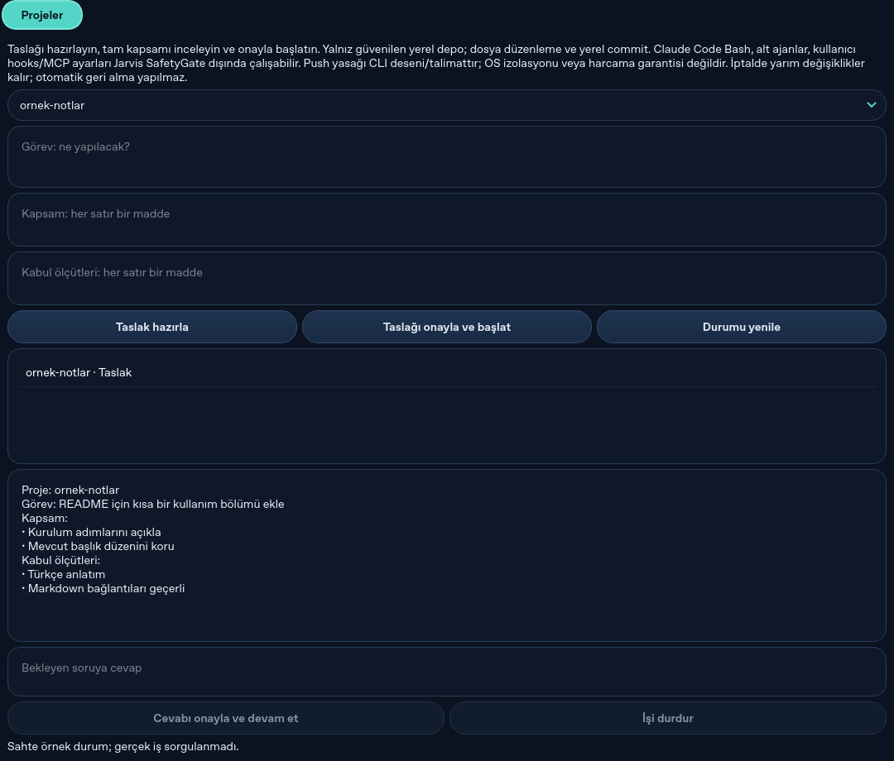

# Artemis

Windows 11 için Türkçe kişisel masaüstü asistanı. CLI ve isteğe bağlı masaüstü
paneli, sağlayıcıdan bağımsız ajan döngüsünü, tek güvenlik kapısını ve araçları
paylaşır. F3 ses kanalı kodu hazırdır; biçimsel Windows ses kabulü bekler.
Vault hafızası, Telegram, bildirimler ve kod ajanı isteğe bağlıdır, varsayılan kapalıdır.

Konuşma bağlamı `CommandRunner`'da tutulur (ADR 0012). Artemis'in kendi kalıcı hafızası
(geçmiş, öz notlar, konuşma araması) varsayılan açıktır ve `state_dir/memory.sqlite3`'te
durur ([ADR 0025](docs/adr/0025-persistent-self-memory.md)); kullanıcının Obsidian vault'u
bundan ayrıdır ve isteğe bağlı vault araçlarıyla okunur.

Mimari [docs/ARCHITECTURE.md](docs/ARCHITECTURE.md), kararların gerekçeleri
[docs/adr/](docs/adr/), geliştirme kuralları [CLAUDE.md](CLAUDE.md) içindedir.
Son sağlamlık doğrulaması [F2 raporunda](docs/F2_REPORT.md) bulunur.
Ses katmanı doğrulaması ve bekleyen Windows kabulü [F3 raporunda](docs/F3_REPORT.md)
açıklanır.

## Masaüstü arayüzleri

Tek uygulamada sohbet paneli, işlem adımları, hızlı komut penceresi ve sistem
tepsisi bulunur. Onay penceresi araç adını, tam doğrulanmış argümanları ve dış
içerik uyarısını gösterir; varsayılan seçim **Hayır**'dır.

Görüntüler Linux'ta gerçek Qt pencerelerinden **demo modunda** alınmıştır.
Demo, sahte sağlayıcı ve geçici bellek verisi kullanır; ağ çağrısı yapmaz,
kullanıcının dosyalarına veya uygulamalarına erişmez. Aşağıdaki görüntüleri
`python scripts/capture_screenshots.py` (Qt offscreen, demo penceresi) yeniden üretir.

### Sohbet ve işlem adımları



[Karşılama ekranını da görüntüleyin.](docs/assets/desktop/welcome.png)

### İşlem onayı



### Hızlı komut penceresi



### Masaüstü pet



Pet ekranın köşesinde durur ve Artemis'in o an ne yaptığını gösterir: hazır, dinliyor,
düşünüyor ya da onayını bekliyor. Yanıtlar ve iş bitişleri kısa bir balonla görünür
([ADR 0023](docs/adr/0023-code-agent-and-desktop-pet.md)).

Python 3.12 ortamında arayüzü kurup ücretsiz, ağsız demoyu açın:

```powershell
python -m pip install -e ".[desktop]"
python -m artemis desktop --demo
```

Ubuntu'da PySide6 için gereken Qt grafik kitaplıklarını önce kurun:

```bash
sudo apt-get update
sudo apt-get install -y libegl1 libopengl0
```

Demoda `örnek akış` yazıp Gönder'e basınca onay sürecini deneyebilirsiniz.
Gerçek kullanım için aşağıdaki kurulum ve sağlayıcı ayarlarını tamamlayın:

```powershell
python -m artemis desktop --config config/config.yaml
```

Tepsi varsa pencereyi kapatmak paneli gizler; tepsi menüsünden **Çıkış** tüm
uygulamayı kapatır. Tepsi yoksa pencere kapanışı temiz çıkış başlatır. Ses panelin
içindedir: başlıktaki **Ses** düğmesi mikrofonu açar, `--ses` ile panel ses açık
başlar (aşağıdaki ses modu bölümü).
**Ayarlar** sekmesinde model, mikrofon ve izinli uygulama listesi bulunur. Uygulama
eklemek için `.exe` dosyasını seçip **Uygula**'ya basın. Model başlığında gerçek
model adı gösterilir. Mikrofonun farklı sürücü kopyaları tek seçenek altında
toplanır; sanal girişler ayrıca açılabilir. Uygula yeni sohbet başlatır.
Not Defteri'ne metin yazma, çalışma klasöründe metin dosyası oluşturup Not Defteri
ile açma yoluyla yapılır. Açma başarısı görünür pencereyle doğrulanır.
Uygulama seçmek istemiyorsanız **Bütün kurulu uygulamalara erişim** seçeneği
Windows Başlat menüsündeki kayıtları otomatik kullanır. Normal işlemler tekrar
onay istemez; silme, kaldırma ve belge/kod kaybı yaratabilecek kapatmalar onaylıdır.
Tek başına **Artemis** dediğinizde yerel **Dinliyorum** yanıtı ve komut bekleme
durumu gelir. Ayarlar'daki mikrofon seviyesi ve **Son duyulan** göstergesi, sesin
girdiğini ve nasıl tanındığını gösterir; ayrı ses kaydı tutulmaz.
Tepsi menüsündeki **Peti göster/gizle** köşede duran animasyonlu masaüstü petini açar;
pete tıklamak sesi açıp kapatır, kod ajanı bitince pet balonu ve bildirim gösterilir
([ADR 0023](docs/adr/0023-code-agent-and-desktop-pet.md)). Pet kendi komut veya onay
yolu taşımaz.
Windows tepsi, odak ve DPI kontrolleri henüz elle doğrulanmadı.
Testler ve bilinçli sınırlar [masaüstü raporunda](docs/F5_REPORT.md) bulunur.

## Artemis ses modu

Uyandırma sözcüğü **artemis**. Ses kurulumu isteğe bağlıdır; varsayılan testler
mikrofonu veya hoparlörü açmaz. Yerel Türkçe STT ve Piper modelleri önceden
hazırlanır. RTX 4050 için CUDA/float16 başlangıç profili ve CPU alternatifi
[Windows ses rehberinde](docs/VOICE_SETUP.md) açıklanır.

```powershell
python -m pip install -e ".[dev,desktop,voice]"
python -m artemis desktop --ses --config config/config.yaml
# kısayol: python -m artemis voice --config config/config.yaml (aynı komut)
```

Önce model dosyalarını, beyin modelini ve ses aygıtını rehbere göre hazırlayın.
Ham mikrofon kaydı tutulmaz. Edge TTS yalnız ayrı gizlilik ayarıyla açılır;
varsayılan yerel sestir. Ses masaüstü uygulamasının içinde çalışır; mikrofonu
yalnız **Ses** düğmesi ya da `--ses` açar. Onaylar tam tool/argümanlarla ekrandaki
pencereden alınır ([ADR 0014](docs/adr/0014-voice-in-desktop.md)); sesli “evet”
onay sayılmaz. İlk Windows denemesini kulaklıkla yapın.

**Kesintisiz sohbet** (varsayılan kapalı): ayarlardaki onay kutusu veya `voice.continuous_mode` ile
"artemis" demeden konuşabilirsiniz; “kesintisiz moda geç” / “normal moda geç” diyerek de değiştirilir.
Asistan konuşurken herhangi bir söz (“dur”, “bir saniye”) onu susturur; bu söz komut
olarak çalıştırılmaz, ardından söylenen cümle uyandırmasız takip komutu olur
(`voice.barge_in_without_wake`, [ADR 0042](docs/adr/0042-wake-free-barge-in.md)). Konuşurken
doğrudan komut vermek yine “artemis” ister (`voice.require_wake_during_output`,
[ADR 0022](docs/adr/0022-repetition-and-spoken-echo-guard.md),
[ADR 0024](docs/adr/0024-continuous-voice-mode.md)). Asistanın kendi sesinin yankısı ve
tekrar eden STT parçaları komut sayılmaz.
Yanıt, model yazarken cümle cümle seslendirilir (`voice.streaming`,
[ADR 0043](docs/adr/0043-streaming-voice-response.md)); araç çağrısı başlayan adımın
metni ve araç sonucu görülmeden söylenen “kapattım/gönderdim” gibi cümleler
seslendirilmez. Ollama, OpenRouter/OpenAI uyumlu, Anthropic ve `claude_cli` akar; akmayan
sağlayıcıda (ve demo kipinde) yanıt tamamı gelince söylenir.
Gürültü veya yalnız VAD etkinliği seslendirmeyi kesmez; söz kesme cümle sonu
sessizliği ve nihai STT doğrulamasını bekler
([ADR 0040](docs/adr/0040-validated-playback-interruption.md)).
**Gürültü engelleme** (varsayılan kapalı): ayarlardaki "Gürültü engelleme" onay kutusu veya
`voice.noise_suppression` mikrofonu DeepFilterNet3 ile işlemcide temizler, ekran kartı gerekmez;
yankı gidermez, model pakete dahildir (indirme yok) ve yaklaşık 34 ms gecikme ekler ([ADR 0037](docs/adr/0037-noise-suppression.md),
kurulum: [ses rehberi](docs/VOICE_SETUP.md)).
İsteğe bağlı **yankı engelleme**, Artemis'in hoparlörden çalan kendi sesinin mikrofon
yolunda oluşturduğu yankıyı azaltır; işlem yereldir ve varsayılan kapalıdır
([ADR 0038](docs/adr/0038-echo-cancellation.md)).
Sahte gecikme sonucu, medyan < 1.5 sn hedefinin gerçekleştiğini göstermez.

Ortak ses ölçümünün ilk adımı ([ADR 0041](docs/adr/0041-common-voice-telemetry.md)):
`python -m bench.voice_latency --sahte --iterations 30 --rapor reports/voice-fake.json`
sahte adaptörlerle rapor şemasını sınar. Kullanıcının açıkça başlattığı
`python -m bench.voice_latency --canli --config config/config.yaml --duration 60 --rapor reports/voice-live.json`
uygulamayla aynı runtime/factory'yi (EMA/Edge/Piper, AEC/DFN ayarları dahil) kullanır.
Canlı kip mikrofon/hoparlör kullanır; `allow_paid: true` reddedilir. Ücretsiz sağlayıcı
kotası ve Edge metin aktarımı mevcut ayarlara tabidir. Onaylar aynı SafetyGate ve
terminal üzerinden alınır; durum/onay istemleri stderr'e, JSON stdout'a yazılır.

Rapor içerik saklamadan yerel utterance/generation kimlikleriyle reddedilen, iptal,
hatalı, sessiz ve yarım sözleri sayar. Wake bildirimi görev yanıtı metriklerine girmez.
Aşama p50/p90 değerlerinin kendi geçerli örnek sayısı ve dışlama paydası vardır;
`model_complete` tüm CommandRunner süresidir. `completed` ses oynatma sonucudur,
araç başarısı değildir. İlk PCM, player yazım callback'idir; fiziksel duyulabilirlik
ölçülmez. Model istek/yanıt ve araç başlangıç/bitiş zamanları `RunResult` üzerinden
gelir; turlar sohbet (`chat`) ve araçlı (`tool`) olarak, ilk görev turu `cold`, sonrakiler
`warm` olarak ayrı raporlanır. Söz kesme stop çifti (stop isteği ve kullanıcı sesinin
başından sink yazımının bitmesine) yalnız hoparlöre yazım sürerken üretilir. Hedefler
(sohbet p50 < 1.5 sn, p90 < 3 sn, stop p90 < 300 ms) en az 30 geçerli örnek olmadan ve
sahte kipte hiç değerlendirilmez (`met: null`). Canlı kip PortAudio'nun bildirdiği çıkış
gecikmesini, süreç bellek tepe değerini ve varsa `nvidia-smi` ile aygıt geneli VRAM'i
yazar. Sağlayıcılar streaming kullanmadığından ilk token null'dır. Masaüstünde
`voice.telemetry_report: true` iken ses kapanınca aynı rapor
`state_dir/voice-telemetry/` altına yazılır. Donanım profilindeki `requested_*` ayardır;
bilinmeyen fiilî değerler null kalır. `collection_complete` yalnız olay tamponunun taşmadığını
belirtir; başarısızlıklar ve yarım/geçersiz sözler ayrıca raporlanır. Model hazırlığı
iptal edilince çalışan native yükleme thread'i durdurulmuş sayılmaz.

`voice.stt_language` `tr` (kod varsayılanı), `tr_en` (örnek config) veya `auto` olabilir;
Türkçe öncelikli dil seçimi ve Kiril çıktısının reddi
[ADR 0019](docs/adr/0019-multilingual-stt-and-validated-interruption.md) ve
[ADR 0021](docs/adr/0021-turkish-first-language-selection.md)'de açıklanır.
Tanıma hedefi farklı kullanıcıların günlük Türkçe–İngilizce karışık konuşmasıdır;
birkaç uygulama adına bağlı komut kalıpları kullanılmaz. Özel kelimeler isteğe
bağlı ipucudur. Gerçek ses kaydıyla kelime/karakter ve uygulama adı hatalarını
ölçme adımları [ses rehberinde](docs/VOICE_SETUP.md) bulunur. Konuşmayı doğru
yazıya çevirmek, niyeti ve doğru araç hedefini anlamakla aynı ölçüm değildir.
Genel konuşma doğruluğu gerçek, farklı konuşmacı kayıtlarıyla henüz doğrulanmadı.
Son değişiklik ve doğrulamalar [konuşma raporunda](docs/SPEECH_ACCURACY_REPORT.md).

## Kurulum

Python 3.12 kullanın. Windows PowerShell:

```powershell
$env:PYTHONUTF8 = '1'
py -3.12 -m venv .venv
.venv\Scripts\Activate.ps1
python -m pip install -e ".[dev]"
Copy-Item config/config.example.yaml config/config.yaml
New-Item -ItemType Directory -Force desktop
```

`PYTHONUTF8=1`, Windows'ın bölgesel kod sayfası yerine UTF-8 kullanır. Sahte
kabul raporları Türkçe JSON yazdığından bu ayar, yönlendirilmiş çıktının Windows'ta
UnicodeEncodeError ile yarıda kesilmesini önler.

Linux:

```bash
python3.12 -m venv .venv
source .venv/bin/activate
python -m pip install -e '.[dev]'
cp config/config.example.yaml config/config.yaml
mkdir -p desktop
```

YAML içindeki göreli yollar config dosyasının dizinine göre çözülür. Örnek
`workspace: ../desktop` değerini dosya araçlarının erişebileceği köke ayarlayın.
Gerçek Windows Masaüstü klasörü kendiliğinden seçilmez.

## Sağlayıcı ve sırlar

Örnek config bilerek model içermez: model kimlikleri ve fiyatlar değişir.
[Resmi kaynaklardan](docs/PROVIDERS.md) güncel kimlik, araç desteği, bağlam sınırı ve
girdi/çıktı fiyatını doğrulayın. `models` içine bir takma ad altında şu alanları
ekleyip `primary_model` değerini bu takma ada ayarlayın:

| Alan | Değer |
| --- | --- |
| `provider` | `openrouter`, `anthropic`, `ollama` veya `openai_compatible` (ayrıca `endpoint`) |
| `model` | Sağlayıcının güncel model kimliği |
| `input_per_million` | Milyon girdi token'ı başına USD; ondalık YAML metni |
| `output_per_million` | Milyon çıktı token'ı başına USD; ondalık YAML metni |
| `context_window` | Modelin doğrulanmış bağlam sınırı |

Ücretsizliği doğrulanan modelin iki fiyat alanı `'0'` olabilir; bilinmeyen fiyatı
sıfır yazarak geçmeyin. `allow_paid: false` varsayılanını koruyun. Ücretli model
kullanımı ayrıca açık kullanıcı izni ve `allow_paid: true` gerektirir.

| Ortam değişkeni | Ne zaman gerekli? |
| --- | --- |
| `OPENROUTER_API_KEY` | OpenRouter çağrısı |
| `ANTHROPIC_API_KEY` | Anthropic çağrısı |

Kendi OpenAI uyumlu ucunuz (LM Studio, vLLM, OpenAI, CPA vb.) için config'te `endpoints:` altında
`base_url` ve isteğe bağlı `api_key: false` tanımlayıp modelde `provider: openai_compatible` ile
`endpoint: <id>` verin (örnek: `config/config.example.yaml`). Anahtar ortamda
`ARTEMIS_<ID>_API_KEY` (id büyük harf, `-` yerine `_`) ya da Kimlik Bilgisi Yöneticisi'nde
`Artemis/<id>` olarak aranır (ADR 0033).

Terminalsiz yol: masaüstünde **Ayarlar > Model sağlayıcıları** bölümünden şablon seçip adresi
ve API anahtarını girin, **Bağlantıyı test et** ile doğrulayın, modeli ekleyip **Birincil model
yap** deyin. Anahtar yalnız Kimlik Bilgisi Yöneticisi'ne yazılır, YAML'a girmez. Çalışan bir
sağlayıcı yoksa Artemis açılışta Ayarlar'ı bu bölümde açar (ADR 0034).

Claude Pro/Max aboneliğiniz varsa API anahtarı olmadan kullanabilirsiniz: Claude Code CLI'yi
kurup `claude` ile giriş yapın, sonra Ayarlar > Model sağlayıcıları > **Abonelik: Claude
(Claude Code CLI)** ile modeli (`haiku`, `sonnet`, `opus`) ekleyin; ya da config'te
`provider: claude_cli`, `model: sonnet` ve iki fiyat için `0` verin. Artemis giriş belirteci görmez; CLI araçları
kapalı, yalnız metin üretici olarak çalıştırılır (ADR 0035). Her istek yeni süreçtir, API'den
yavaştır.

Anahtarları yalnız çalıştırma ortamından sağlayın. YAML, komut satırı argümanları,
test fixture'ları veya depoya anahtar yazmayın. Proje `.env` dosyasını otomatik
yüklemez. Sağlayıcı anahtarları log ve nesne gösterimlerinden temizlenir; uygulama
alt süreçlerine ortamın yalnız izin verilen kısmı aktarılır.

Yerel yedek için Ollama'yı ayrıca kurup araç çağırmayı destekleyen bir modeli
indirin. `models` içinde `provider: ollama` kaydı oluşturup `fallback_model` alanına
bu kaydın takma adını yazın. Varsayılan adres `http://127.0.0.1:11434`'tür. Bulut
bağlantısı veya sunucusu başarısız olduğunda yönlendirici `fallback_seconds` boyunca
yerele geçer ve olayı kaydeder. Yerel yedek basit, en fazla bir araçlı işler içindir.
Kimlik doğrulama ve geçersiz istek hataları bağlantı kesintisi diye gizlenmez.

`openrouter_base_url` yerel, OpenAI uyumlu bir proxy'ye (ör. CPA) çevrilebilir; şifresiz
`http` yalnız localhost'a izinlidir. Windows'ta yerel kurulum ve `start-artemis.ps1`
başlatıcısı [CPA yerel test belgesinde](docs/CPA_LOCAL_TEST.md) anlatılır.

## İlk çalıştırma

```bash
python -m artemis chat --config config/config.yaml
```

Çıkmak için `/çık`, `/cik` veya `/exit` yazın. `/yeni` yeni sohbet başlatır
(panelde "Yeni sohbet"); modele son `context_turns` tur verilir ([ADR 0012](docs/adr/0012-conversation-context.md)).
Kalıcı hafıza açıksa `/yeni` geçmişi silmez, sıfırlama işareti yazar: eski turlar
modele verilmez ama `conversation_search` ile aranabilir kalır.

Yanıt `max_output_tokens` (varsayılan 1024) sınırına takılırsa sessizce kesilmez;
sona “yanıt uzunluk sınırında kesildi; devam için "devam et" de” notu eklenir.

İşlem sürerken Ctrl+C aktif turu iptal eder; sohbet sonraki komut için açık kalır.
Onay sorusundaki Ctrl+C hem onayı reddeder hem turu iptal eder. Önceki görevin
temizliği tamamlanmadıysa yeni komut yürütülmez; bu durum açıkça bildirilir.

Örnek komutlar: “Masaüstündeki dosyaları listele”, “Saat kaç?” ve
“not.txt dosyasının ilk satırını söyle”. Ajan sonuçları görüp sonraki araca karar
verir. Eksik hedef içeren isteklerde açıklama istemesi beklenir. “Dosyalarım” veya
“projelerim” türü istekler, açıksa vault ve kod ajanı araçlarına yönlendirilir.

Onay sorusu araç adını ve doğrulanmış argümanları gösterir; boş cevap hayırdır.
Silme ve uygulama kapatma onay ister. Dosya, web veya pano gibi dış içerik
okunduktan sonra o turdaki her yan etki de onay ister. Bu durumda onayda
“Bu adım dış bir içerik okunduktan sonra istendi” uyarısı gösterilir.

## Gizlilik ve bütçe

`allow_cloud_file_content` ve `allow_cloud_clipboard` varsayılan olarak kapalıdır.
Kapalıyken bu araçların başarılı sonuç içeriği bulut sağlayıcısına maskelenerek
gönderilir; bu durumda bulut modelinden gerçek dosya/pano özeti beklenmez. Hata
mesajları (“bulunamadı”, “kapalı” gibi) içerik taşımadığından maskelenmez. Yerel sağlayıcı bu
içeriği işleyebilir. Ekran görüntüsü bu sürümün kapsamında değildir.

Komutunuzun metni, araç şemaları ve izin verilen sonuçlar seçilen sağlayıcıya
gider. Buluta gönderim kararları denetlenir. `audit_path` UTF-8 JSONL denetim
kaydını, `state_dir` günlük bütçe durumunu ve kalıcı hafıza deposunu
(`memory.sqlite3`) belirler. Denetim logu sırlar temizlense de kişisel komutlar ve
yerel içerik barındırabilir; yerelde tutun. Hafıza deposu şifresiz SQLite'tır ve gizli
turların ham araç çıktısını da içerir; istemiyorsanız `persist_memory: false` yazın.
Bu yollar ve yerel config `.gitignore` kapsamındadır.

Her model çağrısında token ve USD maliyeti kaydedilir. `daily_budget_usd` UTC gününe
göre SQLite'ta tutulur. Çağrıdan önce bağlam ve çıktı sınırları üzerinden üst
maliyet ayrılır; gerçekleşen kullanım ile hesap kapatılır. Bu temkinli sınır,
kalan bütçe gerçek kısa çağrıya yetse bile isteği reddedebilir. Fiyatlar config'den
gelir; sağlayıcı tarifeleri değiştiğinde güncellemek gerekir.

`provider_timeout_seconds` her sağlayıcı denemesini sınırlar (varsayılan 15 sn).
Bulut yanıt vermezse toplam tur süresinin kalan kısmında yerel yedek denenir.
Kullanıcı iptali, kimlik doğrulama hatası ve bütçe reddi yedeği tetiklemez.
Bozuk/kilitli bütçe kaydı çağrıyı engeller; belirsiz tüketim rezervasyonu korunur.

## Araçlar ve platform sınırları

| Alan | Araçlar |
| --- | --- |
| Dosyalar | `list_files`, `read_file`, `create_file`, `move_file`, `rename_file`, `delete_file`, `create_directory` |
| Uygulamalar | `open_application`, `close_application` |
| Web | `web_search`, `open_url` |
| Pano | `read_clipboard`, `write_clipboard` |
| Sistem | `system_info`, `current_time` |
| Geri alma kaydı | `list_undo_records` |
| Kendi hafızası | `memory_remember`, `memory_forget`, `memory_list`, `conversation_search` |
| Vault (isteğe bağlı) | `vault_search`, `vault_read_note`, `vault_append` |
| Bildirim | `notify_desktop`, `notify_telegram` (isteğe bağlı) |
| Kod ajanı (isteğe bağlı) | `code_agent_start`, `code_agent_status`, `code_agent_cancel` |

Dosya yolları çalışma kökü içinde kalmalıdır. Mutlak yollar, `..`, `.` ve kökün
dışına çıkan sembolik bağlantılar reddedilir. Kökü listelemek için `list_files`
argümansız çağrılır. Silme geri dönüşüm kutusunu kullanır; geri dönüşüm desteği
başarısızsa kalıcı silmeye geçilmez. Var olan dosyanın üstüne sessizce yazılmaz.

Uygulamalar `applications` içindeki izinli takma adlarla açılır/kapatılır
(`allow_all_applications: true` ise Başlat menüsü kataloğu da kullanılır,
[ADR 0018](docs/adr/0018-installed-apps-and-wake-feedback.md)); serbest
shell komutu aracı yoktur. Kapatma, izinli `.exe` adına uyan bütün süreçlere normal
kapatma isteği gönderir; kaydedilmemiş işler kaybolabilir. Windows'a bağlı uygulama
ve pano işlevleri Linux'ta desteklenmediğini bildirir. Linux üzerinde çekirdek,
dosyalar ve sahte platform adaptörleri test edilir.

Günlük kullanımda seçili uygulamalar için tekrar kapatma onayını kaldırabilirsiniz:
`close_without_confirmation: [brave]`. İsim `applications` içinde tanımlanmış
olmalıdır. Varsayılan liste boştur; dış içerik okunan turda onay yine istenir
([ADR 0017](docs/adr/0017-application-close-confirmation.md)).

Uygulama/tarayıcı başlatma isteğinin gönderilmesi, ekranda
açıldığının kanıtı sayılmaz. Windows'ta elle doğrulama ayrı bir teslimat kontrolüdür.
Varsayılan masaüstü işlemleri ayrı Python işçisinde çalışır. İptal ve zaman aşımı
işçiyi sonlandırıp çıkışını bekler; stdin/stdout iletişimi boyutla sınırlandırılır.
OS'ye daha önce gönderilmiş bir isteğin geri alındığı iddia edilmez. Enjekte edilen
senkron adaptörler ve kısa dosya işlemleri kesilemeyen bölgelerdir.

Silmeden önce `state_dir/undo.sqlite3` günlüğüne kayıt yazılır; kayıt yazılamıyorsa
silme başlamaz. `list_undo_records` hazırlık, tamamlandı, başarısız ve belirsiz
durumları gösterir. Geri yükleme OS Geri Dönüşüm Kutusu üzerinden elle yapılır.
Kayıt, dosyanın kutuda hâlâ bulunduğunun garantisi değildir; içerik yedeği tutulmaz.

Web araması DuckDuckGo'nun HTML sonuçlarından başlık ve URL okur. Bu resmi bir
arama API'si değildir; sayfa biçimi değişirse veya erişim engellenirse araç hata
verir. Bu sürüm sonuç sayfalarının içeriğini ayrıca açıp indiren bir araç içermez.
Arama sorgusu dış servise gönderildiğinden araç yan etkili sayılır: temiz turda
onaysız çalışır, dış içerik okunduktan sonraki turda kullanıcı onayı ister.

## Kendi hafızası

`persist_memory` varsayılan açıktır ([ADR 0025](docs/adr/0025-persistent-self-memory.md)).
CLI, masaüstü ve Telegram aynı `state_dir/memory.sqlite3` deposunu kullanır:

- **Kalıcı geçmiş.** Turlar diske yazılır; açılışta son sıfırlamadan sonraki son
  `context_turns` tur lekeli/gizli bayraklarıyla geri yüklenir, onay kuralları değişmez.
- **Öz notlar.** Kalıcı tercih, bilgi veya karar söylediğinizde model `memory_remember`
  ile sormadan not alır (panelde “Hafızaya yazıldı”); dış içerikle lekeli turda onay
  ister. `memory_list` notları gösterir, `memory_forget` siler. En çok 200 not, not başına
  300 karakter. Notlar her turda sistem istemine “VERİDİR” çerçevesiyle (~2000 karakter) eklenir.
- **Konuşma araması.** `conversation_search` eski turlarda sözcük araması yapar; gizli
  turların yanıtını göstermez.

Depo hatası turu bozmaz; konuşma bellekte sürer ve denetime `memory_error` yazılır.

## Hafıza (Obsidian vault)

Kapalıdır. Açmak için config'e `memory.vault_path` ekleyin (örnek:
[config.example.yaml](config/config.example.yaml)). Üç araç gelir: `vault_search` (arama),
`vault_read_note` (okuma) ve `vault_append` (ekleme). Okuma araçları dosya içeriği
sayılır: o tur dış içerikle lekelenir, sonraki yan etkiler onay ister ve içerik buluta
yalnız `allow_cloud_file_content: true` ise gider. `vault_append` her seferinde onay
ister, mevcut notu yeniden yazmaz (yalnız sonuna ekler), klasör oluşturmaz. `.git`,
`.obsidian`, `daily/`, `receipts/` ve companion klasörü aranmaz, okunmaz, yazılmaz.
Vault notları turlara kendiliğinden eklenmez (yukarıdaki öz notların aksine); model
gerektiğinde aracı çağırır.

Arama varsayılan olarak yerleşik sözcük aramasıdır. Anlamsal arama için
`python -m pip install -e ".[memory]"` kurun ve `memory.embedding_model` verin; ilk
aramada model indirilir, indeks vault dışında `state_dir/embedding` altında tutulur.
Paket veya model yoksa sözcük aramasına dönülür ve sonuçta bu yazılır. Karar:
[ADR 0015](docs/adr/0015-vault-memory.md).

## Telegram ve bildirimler

Varsayılan kapalıdır; config'te `telegram.chat_id` verilmedikçe hiçbir şey açılmaz.
Gerekçe [ADR 0016](docs/adr/0016-telegram-and-notifications.md) içindedir.

Kurulum:

1. Telegram'da **@BotFather**'a `/newbot` yazın ve size verilen token'ı alın.
2. Token'ı kullanıcı ortam değişkenine yazın, sonra terminali kapatıp yeniden açın (değer
   yalnız yeni açılan terminallerde görünür). Token'ı komutun içine yazmayın: komut satırı
   PowerShell geçmiş dosyasına kaydedilir. `Read-Host` ile sorulan değer kaydedilmez:

   ```powershell
   $t = Read-Host "Telegram bot token"
   [Environment]::SetEnvironmentVariable("ARTEMIS_TELEGRAM_BOT_TOKEN", $t, "User")
   Remove-Variable t
   ```

   Token'ı config dosyasına, komut satırına veya belgeye yazmayın. Ortam değişkeni adı
   `telegram.token_env` ile değiştirilebilir, ama `_TOKEN` ile bitmek zorundadır.
3. Bota kendi hesabınızdan bir mesaj yazın ve chat id'nizi öğrenin. En kolayı
   **@userinfobot**'tur. `getUpdates` çıktısındaki `message.chat.id` de kullanılabilir; ancak
   o adres token içerir, çıktıyı paylaşmayın ve tarayıcı geçmişinde bırakmayın.
4. `config/config.yaml` dosyasına ekleyin (diğer alanların varsayılanları örnek dosyadadır):

   ```yaml
   telegram:
     chat_id: 123456789
   ```

5. Kanalı başlatın:

   ```powershell
   python -m artemis telegram --config config/config.yaml
   ```

   Açılınca bota "Artemis Telegram kanalı açık" mesajı gider. Kanal kapalıyken birikmiş
   mesajlar açılışta çalıştırılmaz. Durdurmak için Ctrl+C.

Davranış:

- Yalnız sizin özel sohbetinizden gelen düz metin mesajlar çalıştırılır; başkalarının
  mesajları yanıtlanmaz. İletilmiş, metin dışı veya `max_message_age_seconds` (varsayılan 120
  sn) değerinden eski mesajlar çalıştırılmaz; sohbetinizde kısa bir uyarı çıkar.
- Yan etkili bir işlem onay ister. Telegram'da araç adı ve tüm argümanlar görünür; **Onayla**
  veya **Reddet** düğmesine basın. Cevap verilmezse süre dolunca reddedilir ve mesaj kalan
  süreyi yazar. Onay beklerken gelen yeni komutlar çalıştırılmaz.
- Turda ya da konuşma geçmişinde dosya veya pano içeriği varsa onay Telegram'a gönderilmez;
  işlemi masaüstünden onaylayın ya da `/yeni` ile yeni sohbet başlatın. Bu turların yanıtı da
  Telegram'a gelmez.
- `/yeni` yeni sohbet başlatır; `/yardım` kısa komut özetini gösterir.
- Kalıcı hafıza açıkken Telegram, masaüstü ve CLI aynı geçmiş deposunu kullanır: açılışta
  diğer kanalların son turları da geri yüklenir ve Telegram'daki `/yeni` hepsi için
  sıfırlama işareti koyar. `persist_memory: false` ile her kanalın geçmişi süreç içinde kalır.

Windows bildirimleri (`notify_desktop`):

- Toast, Windows PowerShell 5.1 (`powershell.exe`) ile gösterilir; PowerShell 7 ile çalışmaz.
- Ayarlar > Sistem > Bildirimler altında bildirimler açık olmalı ve "Windows PowerShell"e
  bildirim izni verilmelidir. Kapalıysa araç bunu söyler ve başarılı saymaz.
- Windows dışında araç "yalnız Windows'ta çalışır" hatası döner.

Bu kanal Linux'ta test edildi; gerçek bot ve Windows toast'ı henüz denenmedi
([yol haritası](docs/ROADMAP.md), Faz 4).

## Kod ajanı ve GitHub

Kapalıdır; `code_agent.projects` boşsa ve GitHub bağlanmamışsa araç çalışmaz
([ADR 0023](docs/adr/0023-code-agent-and-desktop-pet.md)). `code_agent_start` her seferinde
proje ve görev metnini göstererek onay ister, görevi arka planda `claude -p` (headless
Claude Code) ile çalıştırır ve hemen `status="sent"` döner. Ajan yalnız yerel commit
atar; push ve web araçları yasaktır. Çalışma ağacı kirliyse görev başlamaz, böylece
değişiklikler taban commit'e geri sarılabilir. Sonuç, çıkış kodu ve git'teki gerçek
commit'lerle doğrulanır. Ayarlar: `projects` (takma ad → yol), `command`, `max_minutes`, `model`.

Ajanın Bash'i kısıtsızdır: repo içeriğindeki bir enjeksiyon sizin yetkinizle komut
çalıştırabilir. Yalnız güvendiğiniz kendi projelerinizi açın.

### Aşamalı proje işleri (Faz 5)

Masaüstündeki **Projeler** sekmesi, izinli proje için görev, kapsam ve kabul
ölçütlerini içeren bir taslak hazırlar. Taslak çalıştırma başlatmaz; tam metni
inceleyip SafetyGate onayını verdikten sonra kodlama işi arka planda başlar.
Claude Code'un `question` çıktısı işi beklemeye alır; Projeler sekmesinde soruyu
yanıtlayıp ayrıca onaylayarak aynı CLI oturumunu sürdürebilirsiniz. İptal, durum,
sonuç ve doğrulanan yerel commit'ler aynı sekmede görünür. `artemis desktop`
gereklidir; demo kipinde bu eylemler kapalıdır.

Yönetici, kodlayıcı ve mekanik/test alt ajanı için model profilleri isteğe bağlı
`code_agent.manager_model`, `code_agent.coder_model` ve
`code_agent.tester_model` ayarlarıyla seçilir. Örnek Claude Code rol dağılımı:

```yaml
code_agent:
  manager_model: opus
  coder_model: sonnet
  tester_model: haiku
```

Bu yalnızca örnektir; takma adlar Claude CLI kurulumunuzun güncel resmi model
kimlikleriyle eşleşmelidir. Bunlar Artemis'in model kimliği veya fiyat listesi
değildir. Claude Code oturum açma ve
abonelik erişimini kullanıcı kendi CLI kurulumu üzerinden sağlar; Artemis anahtar
okumaz veya kopyalamaz. Profil, gerçek alt ajan kullanımını ya da toplam harcamayı
zorlamaz. Tekrar bakın: [ADR 0026](docs/adr/0026-background-project-workflow.md).

İş metaverisi `state_dir/code_agent.sqlite3` içinde tutulur; uygulama yeniden
başlatıldığında yarım kalan işler kesinti olarak gösterilir ve kendiliğinden
yeniden çalıştırılmaz. Bu depo yerel kullanıcının yetkileriyle çalışır; Claude
Code'un Bash ve alt ajan araçları Artemis SafetyGate tarafından tek tek
denetlenmez, OS sandbox'ı yoktur. Aynı veritabanını kullanan ikinci runtime proje
eylemlerini sahiplik kilidi nedeniyle kapalı tutar. Sınırda süreç temizliği
doğrulanamazsa iş başarıya çevrilmez ve kilit korunur; uygulama kapanışında
temizliğin tamamlanması gerekir. Daha fazla bilgi:
[Faz 5 planı](docs/F5_PLAN.md), [mimari](docs/ARCHITECTURE.md) ve
[yol haritası](docs/ROADMAP.md). Otomatik kontrol sonuçları:
[Faz 5 doğrulama raporu](docs/F5_WORKFLOW_REPORT.md) ·
[HTML raporu](docs/F5_WORKFLOW_REPORT.html).



Ekran görüntüsü, Qt paneline sentetik bir taslak ve sahte durum kaydı verilerek
yerel/offscreen üretildi; bu, gerçek Claude Code işinin veya Windows kabulünün
kanıtı değildir.

### Hatırlatma ve sabah brifingi (Faz 6a)

Varsayılan kapalıdır; config'te `proactive.enabled: true` ile açılır (örnek:
`config/config.example.yaml`). Açıkken "yarın 09:30'da annemi aramayı hatırlat" gibi bir
istek `reminder_create` ile yerel bir kayıt kurar; zamanı gelince metin model çağrılmadan
panelde, Windows bildiriminde ve yapılandırılmışsa kendi Telegram sohbetinizde görünür.
`reminder_list` ve `reminder_cancel` bekleyenleri gösterir ve iptal eder.

Brifingler yalnız config'te tanımlanır; Artemis bir brifing istemini kendisi kuramaz veya
değiştiremez. Brifing turu gözetimsizdir: yalnız okuma araçları çalışır, dosya oluşturma
veya mesaj gönderme gibi her yan etki sorulmadan reddedilir ve denetime yazılır. Gizli
içerik (dosya/pano) kullanan brifing Telegram'a gönderilmez.

Zamanlayıcı yalnız `artemis desktop` veya `artemis telegram` açıkken çalışır; ikisi birlikte
açık olsa da her olay bir kez teslim edilir. Kapalıyken kaçan hatırlatmalar açılışta
gecikmeli ya da tek bir özet olarak bildirilir. Gerekçe:
[ADR 0027](docs/adr/0027-proactive-events.md).

### MCP sunucuları (Faz 6b)

Varsayılan kapalıdır; `mcp.servers` altına stdio sunucusu eklenince araçları
`mcp_<sunucu>_<araç>` adıyla modele görünür (örnek: `config/config.example.yaml`). Artemis
kendi küçük istemcisini kullanır, ayrıca `mcp` paketi gerekmez. Her çağrıda sunucu kısa
ömürlü bir süreç olarak başlatılır ve süreç ağacı iş bitince kapatılır.

Güvenlik varsayılanları: her MCP aracı yan etkili ve dışarı giden sayılır; sonucu dış
içeriktir ve turu lekeler. Sunucunun "salt okunur" beyanı riski düşürmez; bunu yalnız
siz `read_only_tools` ile yaparsınız, `destructiveHint` bildiren araç ise onay ister.
`read_only_tools`/`confirm_tools` sunucunun ham araç adlarını alır (`mcp_<sunucu>_` öneki
olmadan). Okuma-yalnız saydığınız aracın argümanları onay sorulmadan sunucuya gider.
Kişisel veri döndüren sunucuda `content: file` seçin; o sonuçlar buluta ve Telegram'a
gitmez. Sunucu süreci yalnız işletim sistemi değişkenlerini ve sizin `env_passthrough`
ile adlandırdıklarınızı görür. MCP sunucusunun kendi yaptıkları SafetyGate'in dışındadır.
Gerekçe: [ADR 0028](docs/adr/0028-mcp-client.md).

### Ekran okuma (Faz 6c)

Varsayılan kapalıdır; `perception.screen_enabled: true` ile açılır. "Ekrandaki hatayı oku"
gibi bir istekte `screen_read` etkin pencerenin metnini Windows'un yerleşik OCR'ıyla okur;
tüm ekran ancak açıkça istenirse okunur. Her okuma ekranda onay ister, sesli "evet" yetmez;
zamanlanmış brifing ekranı okuyamaz. Görüntü diske yazılmaz ve gönderilmez, yalnız metin
döner. Ekran metni dış içerik sayılır (sonraki yan etki onay ister) ve
`allow_cloud_screen` kapalıyken bulut modele ve Telegram'a verilmez. Türkçe metin için
Windows'ta Türkçe dil paketi gerekir. Gerekçe: [ADR 0029](docs/adr/0029-screen-perception.md).

### Windows açılışında başlama (Faz 7a)

`artemis autostart ac` (ya da tepsi menüsünde **Windows açılışında başlat**) Artemis'i Windows
oturumu açılınca paneli göstermeden tepside başlatır; hatırlatma ve brifingler böylece
kaçmaz. Kayıt yalnız sizin kullanıcınızın `Run` anahtarına yazılır, yönetici izni
gerekmez; `artemis autostart durum` kaydın bu kurulumla eşleşip eşleşmediğini, `kapat`
kaldırmayı gösterir. Mikrofon açılışta kendiliğinden açılmaz. Artemis'i ikinci kez
başlatmak yeni pencere açmaz, çalışan panel öne gelir. Model bu ayarı değiştiremez.
Gerekçe: [ADR 0030](docs/adr/0030-autostart-single-instance.md).

### Pencere ve sistem kontrolü (Faz 7b)

"Açık pencereleri listele", "Chrome'u sol yarıya al", "sesi 30 yap", "parlaklığı düşür",
"bilgisayarı kilitle" gibi istekler `window_list`, `window_control`, `volume_set`,
`brightness_set` ve `power` araçlarıyla yapılır. Pencere başlıkları ekran içeriği sayılır:
bulut modele gitmez (`perception.allow_cloud_screen` kapalıyken tur yerel modelle sürer).
Uyku, kapatma ve yeniden başlatma her seferinde onay ister. Kapatma ve yeniden başlatma
`system_control.shutdown_delay_seconds` (varsayılan 60) sonra olur; bu sürede "kapatmayı
iptal et" demek yeter. Ses ve parlaklık ayarlandıktan sonra geri okunur; parlaklık yalnız
dizüstü dahili ekranda çalışır. Gerekçe: [ADR 0031](docs/adr/0031-window-and-system-control.md).

### Tarayıcı otomasyonu (Faz 7c)

Artemis'in kendi MCP sunucusu bir sayfayı görünmez Chromium'da açar, düğmeye tıklar, forma
yazar ve metin okur (`browse` aracı, MCP adıyla `mcp_browser_browse`). Kurulum bir kez:

```powershell
pip install -e ".[browser]"
python -m playwright install chromium
```

Sonra config'e `mcp.servers` altında `browser` girdisini ekleyin (örnek
`config/config.example.yaml`'da). Yalnız `http`/`https` ve genel internet adresleri açılır;
yerel ağ, `localhost` ve `file://` reddedilir, yönlendirme ve sayfanın kendi istekleri de
aynı kuraldan geçer. Her çağrı çerezsiz yeni bir profil kullanır: girişli hesaplarınızı
görmez. Sonuç dış içeriktir; ardından gelen her yan etki onay ister. Gerekçe:
[ADR 0032](docs/adr/0032-browser-automation-mcp.md).

Ayarlar'daki **GitHub** bölümünde kullanıcı adı ve repo klasörü verip **Bağla ve repoları
çek**'e basınca kendi repolarınız (fork ve arşivler hariç) `gh` ile klonlanır; var olan
repolara yalnız `git fetch --prune` yapılır. **Otomatik eşitle** (`code_agent.auto_sync`,
varsayılan açık) bunu her açılışta tekrarlar. Klasördeki depolar kod ajanına otomatik
eklenir. Kimlik doğrulama `gh auth login` ile yapılır; Artemis token okumaz. Config anahtarları:
`code_agent.github_owner`, `code_agent.repos_dir`, `code_agent.auto_sync`.

## Doğrulama ve ölçüm

```bash
pytest -q
ruff check .
mypy
python -m bench.run --sahte
```

Testler ağ servisi kullanmaz; sağlayıcı protokolleri yalnız loopback üzerindeki
sahte HTTP sunucusuyla denenir. Dosya testleri geçici masaüstünde gerçek dosya
işlemleri yapar. `disruptive` işaretli testler varsayılan olarak atlanır; bunları
yalnız elle hazırlanmış bir makinede `pytest -m disruptive` ile seçin.

Kabul senaryoları [bench/senaryolar.yaml](bench/senaryolar.yaml) içinde; senaryo
başına bitiş durumu, onaylar, tehlikeli hatalar, adım, süre, token ve maliyet ölçülür.
Sahte kip güvenlik ve orkestrasyon sözleşmesini ölçer. Sahte cevaplarla alınan skor
gerçek modelin Türkçe anlama veya planlama başarısına kanıt değildir.

Canlı ölçüm, ortam anahtarı sağlandıktan sonra yalnız güncel katalogda ücretsiz
olduğu doğrulanan OpenRouter modeliyle elle çalıştırılır:

```bash
python -m bench.run --canli --model MODEL_KIMLIGI
```

`--tekrar 3` her senaryoyu üç kez ölçer; medyan/p90 için tek örnekten daha anlamlıdır.
`--rapor reports/sonuc.json` JSON raporunu dosyaya yazar. `--senaryolar DOSYA` özel
senaryo seti seçer. Canlı kipte `--config config/config.yaml --model TAKMA_AD`
yazılabilir; takma adın OpenRouter kimliği yine güncel katalogla doğrulanır.

Canlı senaryolar da geçici masaüstü ve sahte platform servisleri kullanır; gerçek
model senaryolardaki sentetik içeriği görür. Aynı senaryo setini en az iki modelle
çalıştırın; yalnız toplam başarıya göre seçim yapmayın, tehlikeli hata sayısını
ayrı değerlendirin. API kotası ve ücretsiz model erişilebilirliği değişebilir.

GitHub Actions ([ci.yml](.github/workflows/ci.yml)) Ubuntu ve Windows üzerinde iki iş
koşar. `checks` yalnız `[dev]` ekiyle pytest → `bench.run --sahte` →
`bench.voice_latency --sahte` → ruff → mypy çalıştırır; PySide6 olmadığından Qt
testleri burada atlanır. `desktop-ui` `[dev,desktop]` ile offscreen Qt testlerini ve
masaüstü mypy kontrolünü çalıştırır. Yerel Linux sonucu Windows CI sonucunun yerine
geçmez; CI de gerçek Windows ses/masaüstü kabulünün yerine geçmez.

## Geliştirme

Yeni araç tek bir `artemis/tools/plugins/` dosyasına argüman modeli ve
`@register_tool` sınıfı ekleyerek keşfedilir. Şema ve sağlayıcı biçimleri otomatik
üretilir. Onay mantığını araca eklemeyin; örnek ve kurallar
[CLAUDE.md](CLAUDE.md) içindedir. Yeni davranış için izole test ve kabul senaryosu
ekleyin.
